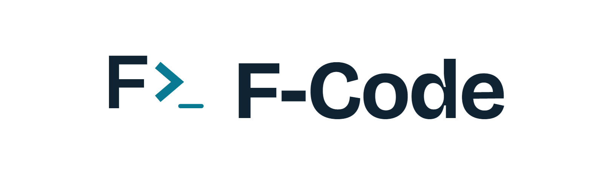
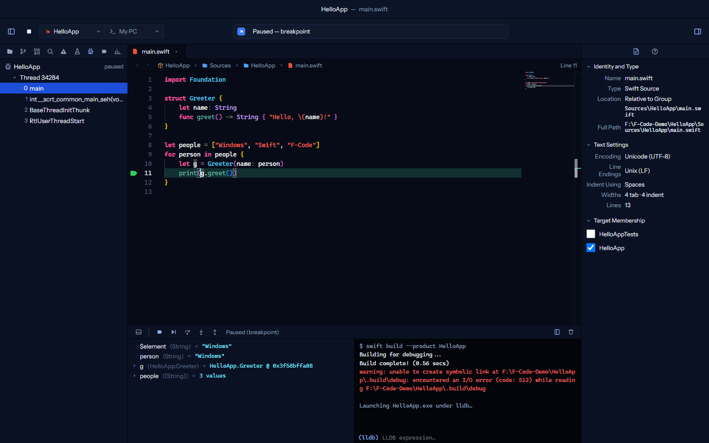
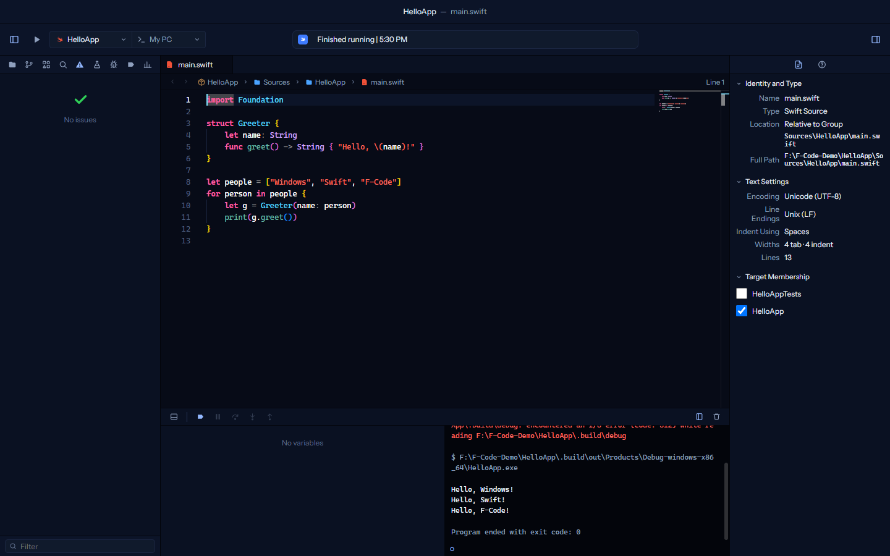
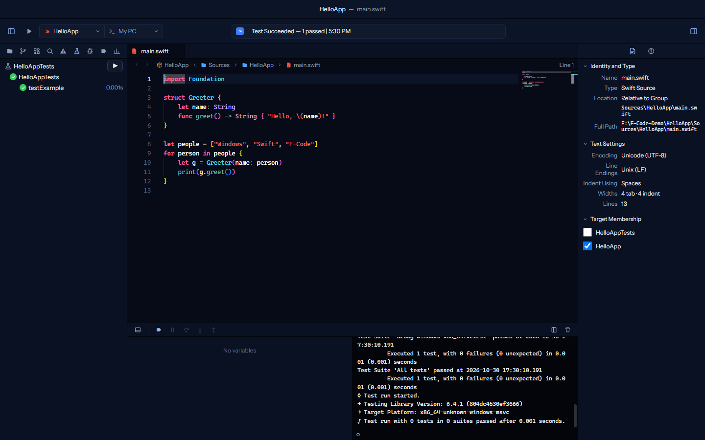
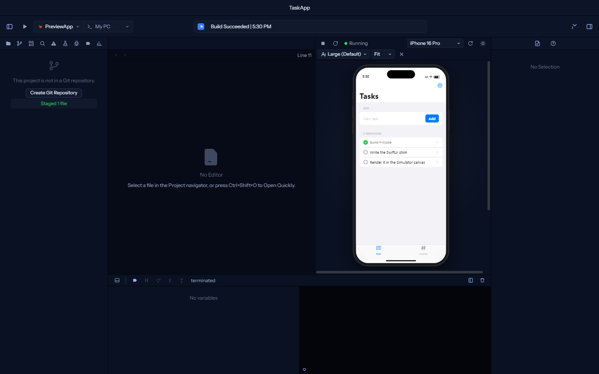
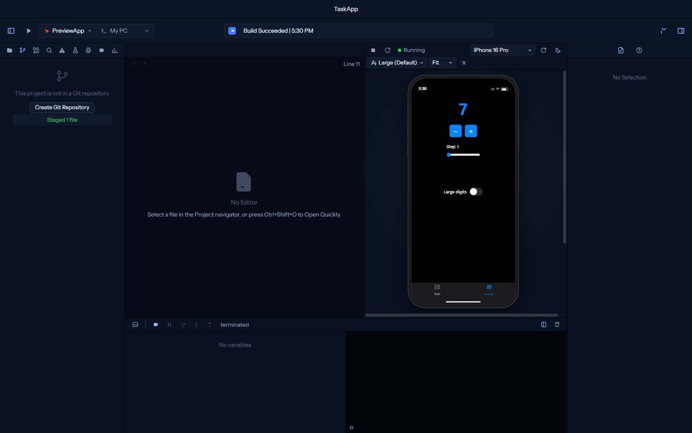
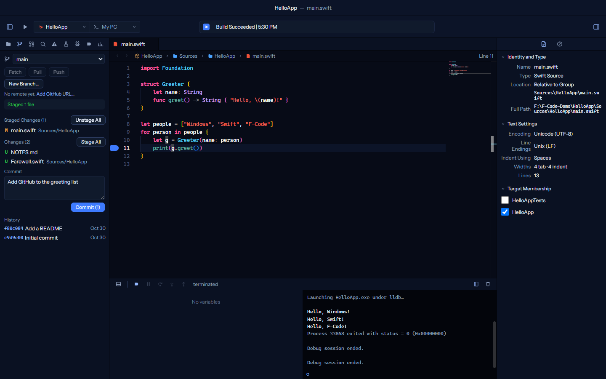
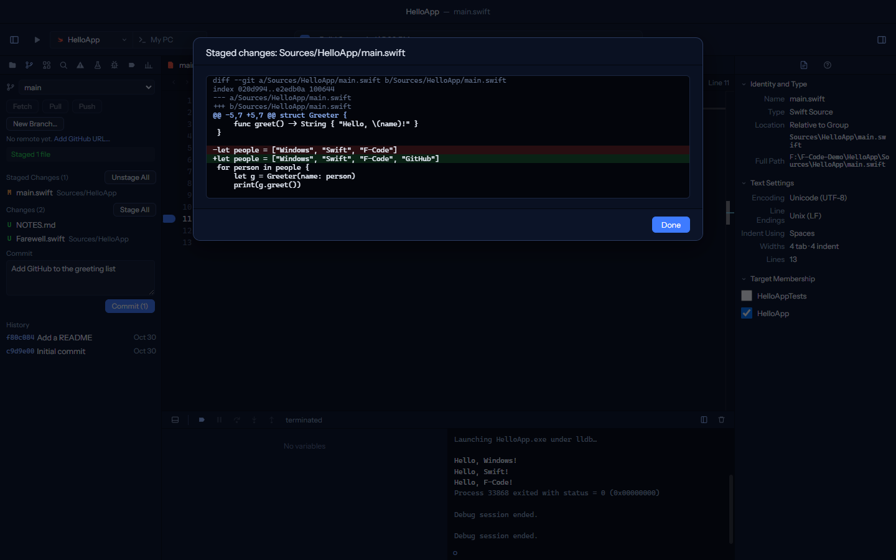
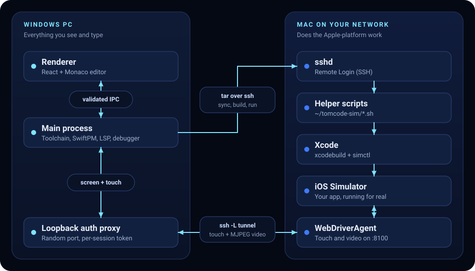
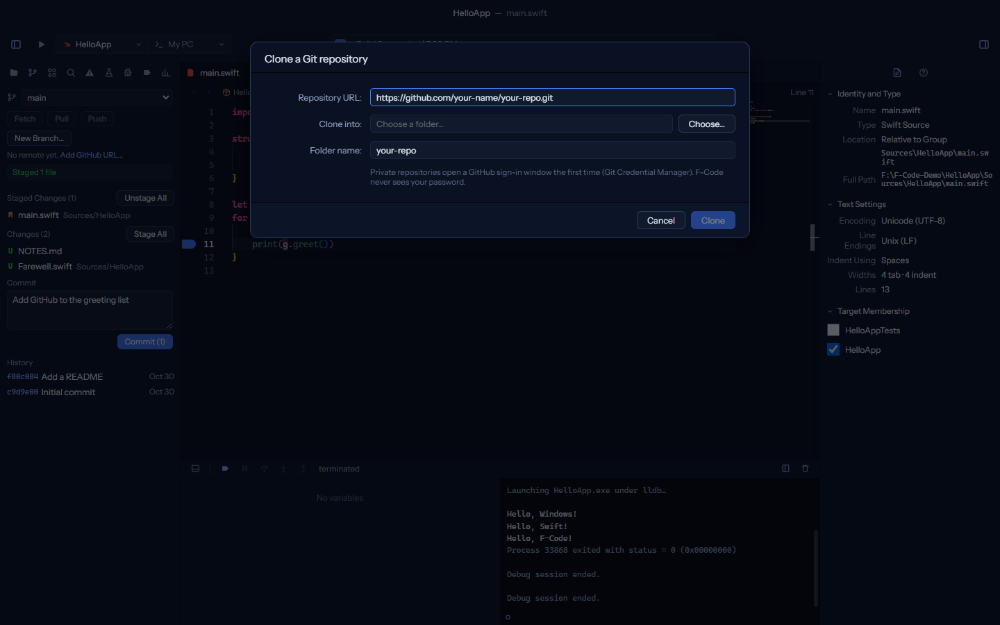

<div align="center">

<picture>
  <source media="(prefers-color-scheme: dark)" srcset="assets/brand/f-code-logo-light.png">
  
</picture>

### Write Swift on Windows. See it run on a real iPhone Simulator.

**F-Code** is an Xcode-style IDE for Windows: build, test and debug Swift with the official toolchain,<br>
then press Run and watch your app come alive in a real iOS Simulator on a Mac down the hall,<br>
streamed back into the editor with touch, swipe, scroll and typing.

[](LICENSE)
[](CHANGELOG.md)
[-7fe3ff?style=flat-square&labelColor=0b1220&logo=windows11&logoColor=white)](#-requirements)
[](https://www.swift.org/install/windows/)
[](https://www.electronjs.org/)

[**Quick start**](#-quick-start) &nbsp;·&nbsp; [**Tour**](#-a-quick-tour) &nbsp;·&nbsp; [**Shortcuts**](#-keyboard-shortcuts) &nbsp;·&nbsp; [**Use a Mac**](#-run-it-on-a-real-ios-simulator) &nbsp;·&nbsp; [**Security**](#-security-architecture) &nbsp;·&nbsp; [**FAQ**](#-faq)

<br>



<sub>Paused on a breakpoint in F-Code: call stack, source, variables and the LLDB console. This is the Windows toolchain running locally.</sub>

</div>

<br>

## Why F-Code?

Swift runs on Windows now, but the tools around it are still thin. Apple only ships Xcode and the iOS Simulator for Mac, which leaves a Windows developer with a text editor and a terminal. F-Code puts the Xcode workflow back on your PC.

- **It feels like Xcode.** Navigator sidebar, source editor with a jump bar, inspectors, a debug area with variables and a console, Xcode-style activity viewer and issue list, and the familiar shortcuts with <kbd>Ctrl</kbd> in place of <kbd>⌘</kbd>.
- **It uses the real tools.** No custom compiler, no emulation. F-Code drives the official Swift toolchain (`swift build`, `swift run`, `swift test`), SourceKit-LSP for code intelligence and `lldb-dap` for debugging.
- **It reaches a real iPhone Simulator.** Point it at any Mac on your network and F-Code builds with the real Xcode, runs your app in the real iOS Simulator, and streams the screen into the window with touch and typing. No Mac screen, no remote desktop, no second keyboard.
- **It is careful with the connection.** F-Code controls another machine over SSH, so the code that touches it validates every value, pins host keys, and keeps its keys locked to your Windows account. [Details below](#-security-architecture).

> [!NOTE]
> Apple-platform SDKs can only be used on Apple hardware, so F-Code never builds iOS or macOS apps on Windows. The Windows toolchain builds Swift packages that run on Windows, and the Mac does the Apple-platform work.

<br>

## ⚡ Quick start

You need [Node.js](https://nodejs.org/) 20 or newer and the [Swift toolchain for Windows](#-requirements). Then:

```powershell
git clone https://github.com/Twirledd/f-code.git
cd f-code
npm install
npm run dev
```

That runs F-Code from source with hot reload. No installer, no certificate prompts.

> [!TIP]
> If PowerShell says *"running scripts is disabled on this system"*, you do not need to change any Windows setting. Type `npm.cmd` instead of `npm` (for example `npm.cmd run dev`), or run the same commands in Command Prompt.

**Your first minute**

1. Click **Create New Project…** (Command Line Tool, Library, ArgumentParser Tool or SwiftUI App) or open any folder that contains a `Package.swift`.
2. Press <kbd>Ctrl</kbd>+<kbd>B</kbd> to build, <kbd>Ctrl</kbd>+<kbd>R</kbd> to run, <kbd>Ctrl</kbd>+<kbd>U</kbd> to test.
3. Click in the gutter to set a breakpoint, then press <kbd>Ctrl</kbd>+<kbd>Shift</kbd>+<kbd>R</kbd> to debug.
4. Project on GitHub? Choose **Clone Git Repository…** on the Welcome screen (or *File ▸ Clone Repository…*), paste the URL and F-Code downloads it and opens it. See [Source control](#-source-control).
5. Got a Mac? Follow [Run it on a real iOS Simulator](#-run-it-on-a-real-ios-simulator).

F-Code detects the Swift toolchain when it starts. Open **Settings** (<kbd>Ctrl</kbd>+<kbd>,</kbd>) to see what it found and what, if anything, is missing.

<details>
<summary><b>Prefer a standalone .exe?</b></summary>

<br>

```powershell
npm run dist
```

builds a Windows installer and a portable `.exe` into `dist/`. The build is unsigned, so Windows SmartScreen will warn on first run ("More info", then "Run anyway"). Running from source with `npm run dev` avoids that entirely.

</details>

<br>

## 🔭 A quick tour

<table>
  <tr>
    <td width="50%" valign="top">
      
      <br><b>Edit, build, run.</b> Monaco with a Swift grammar and dark and light themes. Console output and build errors land right where you expect them.
    </td>
    <td width="50%" valign="top">
      
      <br><b>Test navigator.</b> <code>swift test</code> results appear as a tree with pass and fail marks and timings, with inline issue banners in the editor.
    </td>
  </tr>
  <tr>
    <td width="50%" valign="top">
      
      <br><b>Simulator canvas, on Windows.</b> A clean-room SwiftUI-compatible module lets <code>import SwiftUI</code> code compile on Windows and render inside an iPhone frame, live. <a href="#-simulator-canvas-swiftui-preview-on-windows">How it works</a>
    </td>
    <td width="50%" valign="top">
      
      <br><b>Light, dark, Dynamic Type, rotation.</b> Flip appearance, text size and device (iPhone 16 Pro, iPhone SE, iPad) from the canvas toolbar and see the app respond.
    </td>
  </tr>
  <tr>
    <td width="50%" valign="top">
      
      <br><b>Source control, built in.</b> Branches, staged and unstaged changes, commit, fetch, pull, push and history, right in the sidebar. <a href="#-source-control">Details</a>
    </td>
    <td width="50%" valign="top">
      
      <br><b>Review before you commit.</b> Click any changed file to see exactly what changed, line by line.
    </td>
  </tr>
</table>

<br>

## ✨ Features

| | |
| --- | --- |
| **Project** | Welcome window, New Project templates, project navigator with file operations, Open Quickly (<kbd>Ctrl</kbd>+<kbd>Shift</kbd>+<kbd>O</kbd>), Find in Project |
| **Editor** | Monaco with a Swift grammar, jump bar, minimap, and dark and light themes |
| **Code intelligence** | SourceKit-LSP: completion, hover and Quick Help, jump to definition, live diagnostics, symbol navigator |
| **Build and test** | Build / Run / Test / Clean with an Xcode-style activity viewer, Issue navigator, Test navigator and inline issue banners |
| **Debugging** | LLDB through `lldb-dap`: breakpoints, stepping, call stack, variables, console and LLDB expressions |
| **Source control** | Clone Repository from GitHub (or any Git host), branches, stage and discard, diff viewer, commit, fetch, pull, push and history. Uses your PC's Git. |
| **Simulator canvas** | Live SwiftUI-style preview on Windows, no Mac needed |
| **Real iOS Simulator** | Remote Mac build and run, with touch, swipe, scroll, typing, paste and a live frame-rate readout |
| **Remote tests** | `xcodebuild test` on the Mac when the destination is a Mac |
| **Shortcuts** | Xcode's keyboard shortcuts, with <kbd>Ctrl</kbd> in place of <kbd>⌘</kbd> |

<br>

## 🎹 Keyboard shortcuts

Everything is also in the menus. The most used:

| Action | Shortcut | | Action | Shortcut |
| --- | --- | --- | --- | --- |
| Build | <kbd>Ctrl</kbd>+<kbd>B</kbd> | | Show Project navigator | <kbd>Ctrl</kbd>+<kbd>1</kbd> |
| Run | <kbd>Ctrl</kbd>+<kbd>R</kbd> | | Show Issue navigator | <kbd>Ctrl</kbd>+<kbd>5</kbd> |
| Test | <kbd>Ctrl</kbd>+<kbd>U</kbd> | | Show Test navigator | <kbd>Ctrl</kbd>+<kbd>6</kbd> |
| Debug | <kbd>Ctrl</kbd>+<kbd>Shift</kbd>+<kbd>R</kbd> | | Show Debug navigator | <kbd>Ctrl</kbd>+<kbd>7</kbd> |
| Stop | <kbd>Ctrl</kbd>+<kbd>.</kbd> | | Hide / show Debug area | <kbd>Ctrl</kbd>+<kbd>Shift</kbd>+<kbd>Y</kbd> |
| Clean Build Folder | <kbd>Ctrl</kbd>+<kbd>Shift</kbd>+<kbd>K</kbd> | | Hide / show Navigator | <kbd>Ctrl</kbd>+<kbd>0</kbd> |
| Open Quickly | <kbd>Ctrl</kbd>+<kbd>Shift</kbd>+<kbd>O</kbd> | | Toggle Canvas | <kbd>Ctrl</kbd>+<kbd>Alt</kbd>+<kbd>Enter</kbd> |
| Find in Project | <kbd>Ctrl</kbd>+<kbd>Shift</kbd>+<kbd>F</kbd> | | Resume Preview | <kbd>Ctrl</kbd>+<kbd>Alt</kbd>+<kbd>P</kbd> |
| Jump to Definition | <kbd>Ctrl</kbd>+<kbd>Alt</kbd>+<kbd>J</kbd> | | Toggle Breakpoint | <kbd>Ctrl</kbd>+<kbd>&#92;</kbd> |
| Jump to Line | <kbd>Ctrl</kbd>+<kbd>L</kbd> | | Step Over / Into / Out | <kbd>F6</kbd> / <kbd>F7</kbd> / <kbd>F8</kbd> |
| Toggle Comment | <kbd>Ctrl</kbd>+<kbd>/</kbd> | | Settings | <kbd>Ctrl</kbd>+<kbd>,</kbd> |
| Show Source Control navigator | <kbd>Ctrl</kbd>+<kbd>2</kbd> | | Clone Repository… | <kbd>Ctrl</kbd>+<kbd>Alt</kbd>+<kbd>Shift</kbd>+<kbd>O</kbd> |

<br>

## 🧩 How it works

<p align="center">
  
</p>

| Part | Where | Role |
| --- | --- | --- |
| `src/main` | Windows | Electron main process: Swift toolchain detection, SwiftPM runner, SourceKit-LSP and `lldb-dap` clients, the Mac bridge (`remote-mac.ts`), key handling (`keystore.ts`), input validation (`validate.ts`), the authenticated tunnel proxy (`auth-proxy.ts`) |
| `src/preload` | Windows | `contextBridge` API exposed to the renderer as `window.xcode` |
| `src/renderer` | Windows | React UI, zustand store, Monaco integration, Simulator canvas |
| `swiftui-shim/` | Windows | Clean-room SwiftUI-compatible module used for the local canvas |
| `scripts/sim-headless/` | Mac (copied over SSH) | Shell helpers: simulator boot, WebDriverAgent runner, keep-alive LaunchAgent, simulator trim, server mode |

**Remote build flow.** F-Code syncs the package to `~/TomCodeProjects/<name>` on the Mac (tar over ssh), runs `xcodebuild -scheme <App> -destination 'platform=iOS Simulator,…'`, wraps the result in an `.app`, installs and launches it with `simctl`, and streams the screen back. Build errors appear in the Issue navigator with local file paths and the app's output appears in the console.

**Input and video.** Out of the box the canvas is view-only at roughly 3-4 fps (`simctl` screenshots). *Settings ▸ Mac ▸ Enable* builds Appium's [WebDriverAgent](https://github.com/appium/WebDriverAgent) (pinned to v5.15.9, the last release that fits Xcode 15.2) on the Mac once. After that, Run also starts it inside the Simulator and tunnels to it over SSH: click is tap, drag is swipe, the mouse wheel scrolls, keyboard and paste type, and the stream becomes MJPEG (12-17 fps measured on a 2015 MacBook Air). Input is queued in order because WebDriverAgent does not preserve the order of concurrent requests.

The Mac-side directory is named `~/tomcode-sim` for historical reasons and is kept so existing setups keep working. It is an implementation detail and is not shown in the product UI except in copyable commands.

<br>

## 📋 Requirements

<details open>
<summary><b>Windows PC</b></summary>

<br>

1. Windows 10 or 11 (x64)
2. [Visual Studio 2022 Build Tools](https://visualstudio.microsoft.com/downloads/) with the *Desktop development with C++* workload and a Windows SDK
3. The [Swift toolchain](https://www.swift.org/install/windows/) 6.x
4. OpenSSH client (`ssh`, `ssh-keygen`, `tar`; all ship with Windows)
5. [Node.js](https://nodejs.org/) 20+ to run or build from source

```powershell
winget install --id Microsoft.VisualStudio.2022.BuildTools --override "--quiet --wait --add Microsoft.VisualStudio.Workload.VCTools --includeRecommended"
winget install --id Swift.Toolchain -e
```

F-Code detects the toolchain at launch and, if something is missing, shows the exact commands in *Settings*, each with a copy button.

</details>

<details>
<summary><b>Mac (only for the real iOS Simulator features)</b></summary>

<br>

1. A Mac on the same network as the PC, reachable by hostname or IP
2. Xcode with at least one iOS Simulator runtime installed (the project was developed against Xcode 15.2 / iOS 17.2)
3. *System Settings ▸ General ▸ Sharing ▸ Remote Login* switched on (SSH)
4. A user account you can sign in with. No admin rights are needed except for the optional sudoers rule below.

</details>

<br>

## 🌿 Source control

F-Code works with the Git that is already on your PC ([Git for Windows](https://git-scm.com/download/win)), so your existing repositories, settings and hooks behave as they always have.

- **Clone Repository…** on the Welcome screen, or *File ▸ Clone Repository…*. Paste an `https://github.com/owner/repo.git` URL (SSH forms work too), choose a folder, and F-Code clones it with a progress bar, then opens the project.
- **Source Control navigator** (<kbd>Ctrl</kbd>+<kbd>2</kbd>): switch or create branches, see staged and unstaged changes, stage, unstage or discard files, read the diff, write a commit message and commit, then Fetch, Pull and Push. A new project without a repository offers **Create Git Repository**, and a repository without a remote lets you paste a GitHub URL to push to.
- **Signing in to GitHub.** For private repositories the first clone or push opens GitHub's own sign-in window through Git Credential Manager, which ships with Git for Windows. F-Code never sees or stores your password or token.
- **Pull is fast-forward only.** If your branch and the remote have both moved, F-Code tells you and leaves the merge or rebase to you, so it never rewrites history behind your back.



<br>

## 🍎 Run it on a real iOS Simulator

1. **Connect.** In *Settings ▸ Mac*, enter the Mac's hostname (or IP) and your user name there. F-Code creates its own ed25519 key (`~/.ssh/xcode_ed25519`) on the PC. Copy the one-line command shown (the copy icon beside it) and run it once in Terminal on the Mac to authorise the key. The private key never leaves the PC.
2. **Trust the host.** The first time, F-Code shows the Mac's host-key fingerprints. Compare them with `ssh-keygen -lf /etc/ssh/ssh_host_ed25519_key.pub` on the Mac and click *Trust*. The key is then pinned.
3. **Pick a destination.** Choose an iOS Simulator in the destination menu next to the scheme and press Run.
4. **Touch and typing (optional).** *Settings ▸ Mac ▸ Enable* builds WebDriverAgent on the Mac once (about ten minutes).

F-Code copies its helper scripts to `~/tomcode-sim/` on the Mac every time it connects, so every command shown in Settings exists there.

<details>
<summary><b>Quiet the Mac for headless use: <code>mac_server_mode.sh</code></b></summary>

<br>

Run these **on the Mac**, in Terminal, as yourself (not root). The script turns the Mac into a quiet, never-sleeping simulator host: Spotlight indexing off, display and disk sleep off on AC, Photos and Siri analysis agents stopped, automatic update checks and window animations off. Nothing is deleted, every change is reversible, and the current values are saved first to `~/tomcode-sim/server-mode.backup`.

```bash
bash ~/tomcode-sim/mac_server_mode.sh status          # read-only: what is running, what apply would change
bash ~/tomcode-sim/mac_server_mode.sh install-sudoers # once; asks for your password
bash ~/tomcode-sim/mac_server_mode.sh apply           # apply the changes (asks for confirmation)
bash ~/tomcode-sim/mac_server_mode.sh revert          # put everything back from the backup
bash ~/tomcode-sim/mac_server_mode.sh remove-sudoers  # remove the sudoers rule again
```

The system-wide parts run through `sudo -n`, which never prompts and never reuses a cached password, so `apply` and `revert` only work after `install-sudoers`. That installs `/etc/sudoers.d/tomcode-server-mode` (checked with `visudo -cf`), which lets **your user only** run exactly the `mdutil`, `pmset` and `softwareupdate` forms the script uses and nothing else. It does not touch SIP, the firewall, FileVault, networking, Remote Login, crash reporting, or Xcode/CoreSimulator. A backup file that anyone else could have written is refused, and the script never evaluates it as code.

</details>

<details>
<summary><b>Always-on simulator: boot once, attach in about 20 seconds</b></summary>

<br>

```bash
bash ~/tomcode-sim/mac_ultra_mode.sh apply max   # server mode + trimmed simulator + LaunchAgent
bash ~/tomcode-sim/mac_ultra_mode.sh status
bash ~/tomcode-sim/mac_ultra_mode.sh revert
```

This applies server mode, trims about 60 background services inside the simulated iOS (the push daemon `apsd` alone wrote 74% of all log lines), and installs the LaunchAgent `dev.tomcode.simhost`, which boots one simulator at login and keeps it and WebDriverAgent running. F-Code then simply attaches: no boot, no agent start, live in about 20 seconds. The trim is runtime-only, so the keep-alive re-applies it after every simulator boot and waits for the boot storm to settle before starting the agent (measured cold start: about 6.5 minutes to ready). Unattended restarts need Automatic login. `max` also disables simulator audio.

Rules that keep it healthy: keep the Mac plugged in with the lid open, and never quit Simulator.app (that shuts every device down).

</details>

<details>
<summary><b>Headless viewer without the app</b></summary>

<br>

Standalone tools in `scripts/sim-headless/` work without F-Code. `run.ps1` boots the Simulator headless and opens a browser viewer at `127.0.0.1:9100`, with `win_viewer.py` and `mac_wda.sh` behind it:

```powershell
.\scripts\sim-headless\run.ps1 -MacName my-mac.local -User me -Udid <simulator-id>
```

Find the simulator id on the Mac with `xcrun simctl list devices booted`.

</details>

<br>

## 🔒 Security architecture

F-Code controls another machine over SSH and runs shell scripts on it, so the boundary between "text the user or a project controls" and "a command" is treated as the main attack surface.

| Defence | What it does |
| --- | --- |
| **Validate at the boundary, quote at the sink** | Every simulator UDID, bundle id, scheme, product, appearance and connection field is validated in `src/main/validate.ts`, then shell-quoted (`q()`) or XML-escaped (`xmlEscape()`) wherever it reaches `ssh`, `xcrun simctl`, `xcodebuild`, `pkill` or a generated plist. IPC handlers re-validate everything from the renderer. The Mac-side scripts re-validate UDIDs themselves. |
| **Key handling** | The private key is created by F-Code, locked to the current Windows account (`icacls`, or `chmod 600/700` elsewhere) and re-checked, failing closed, before every connection. An optional passphrase is stored with Electron `safeStorage` (Windows DPAPI) and loaded with `ssh-add` through an `SSH_ASKPASS` helper that receives the secret only in the child's environment. It needs the Windows *OpenSSH Authentication Agent* service, which F-Code never enables for you. |
| **Host-key pinning** | `StrictHostKeyChecking=yes` with a private known-hosts file and a stable `HostKeyAlias`. An unknown host's fingerprints are shown and it is pinned only after you click *Trust*. A changed key is a hard failure with an impersonation warning. |
| **Bearer-token tunnel** | WebDriverAgent (touch, typing, MJPEG video) is reached through ssh `-L` tunnels. In front of them F-Code runs loopback proxies on random ports that require a per-session bearer token (`crypto.randomBytes`, 192 bits): a wrong or missing token gives 401, a foreign `Host` header gives 421, and the token is stripped before forwarding. WebDriverAgent is never opened to the LAN. Ports are chosen with a retry loop to close the free-port race. |
| **No `eval`, no ambient sudo** | `mac_server_mode.sh` parses its backup with a whitelist of known keys and strictly shaped values, requires it to be owned by you with mode 600/400, and uses `sudo -n` with a scoped, `visudo`-checked sudoers rule (`timestamp_timeout=0`, `tty_tickets`). |
| **Git commands** | F-Code runs `git` directly, never through a shell. Repository URLs are limited to `https://`, `ssh://` and `user@host:path` forms (no embedded passwords, no `ext::` or `file:` transports, nothing that starts with `-`), branch names, folder names and file paths are validated, commit messages travel on standard input, and only files that git itself lists as changed can be staged or discarded. Discarding asks first. |
| **Tests** | `npm run test:security` covers injection payloads, the proxy, the port-retry logic and the Git layer against real temporary repositories. |

**Honest limits.** The ssh `-L` listeners are still loopback ports, so a local process that scans them can connect without the token. The token protects against web pages and anything that only knows the proxy port. ssh `-W` stdio forwarding would close this at a latency cost. Without the optional passphrase the key is protected by file permissions alone.

**Reporting a vulnerability.** Please report it privately through the repository's **Security** tab rather than in a public issue.

<br>

## 🎨 Simulator canvas (SwiftUI preview on Windows)

F-Code ships a clean-room, SwiftUI-compatible module in `swiftui-shim/` whose target is named `SwiftUI`, so app code written as `import SwiftUI` compiles unchanged on Windows and against Apple's SwiftUI on a Mac. An App target (`@main struct … : App`) built against it runs as a Windows process that streams its view tree to F-Code over stdin/stdout. The canvas lays it out and paints it inside an iPhone or iPad frame with status bar, tab bars, navigation stacks, sheets and alerts, light and dark mode, Dynamic Type and rotation. Taps, typing, toggles, sliders and pickers are sent back to the app, which updates its state and re-renders.


<details>
<summary><b>Supported and not supported</b></summary>

<br>

**Supported:** `View` / `@ViewBuilder`, `@State`, `@Binding`, `@StateObject`, `@ObservedObject`, `@EnvironmentObject`, `@Environment`, `@AppStorage`, `Text`, `Image(systemName:)`, `Label`, stacks, grids, `ScrollView`, `GeometryReader`, `List` / `ForEach` / `Section` / `Form`, `NavigationStack`, `TabView`, `Button`, `Toggle`, `TextField` / `SecureField` / `TextEditor`, `Slider`, `Stepper`, `Picker`, `DatePicker`, `ColorPicker`, `ProgressView`, `Menu`, shapes, gradients, `.sheet` / `.alert` / `.confirmationDialog`, `.toolbar`, `.searchable`, lifecycle modifiers and the common layout, styling and gesture modifiers.

**Not supported:** UIKit, `@Observable` macros (use `ObservableObject`), MapKit, StoreKit and other Apple frameworks, Core Animation-level effects. Previews approximate iOS. The Mac remains the source of truth for shipping.

Package manifests must guard the Windows shim with `#if os(Windows)`. The App template does this.

</details>

<br>

## 🔧 Development

```powershell
npm install
npm run dev            # launch with hot reload
npm run typecheck
npm run build          # production bundle in out/
npm run test:security  # injection / proxy / retry tests
npm run smoke          # Playwright end-to-end test (set XC_MAC=user@host to include the Mac phase)
npm run dist           # Windows installer + portable exe in dist/
node scripts/readme-shots.mjs                       # retake the README screenshots (needs a build first)
node_modules/.bin/electron scripts/make-brand.cjs   # regenerate the icon set from assets/brand/*.svg
```

The stack is Electron, React, TypeScript, Monaco and zustand, bundled with electron-vite. The smoke test drives the built app with Playwright, builds and debugs a sample package, and renders the Simulator canvas.

<br>

## ❓ FAQ

<details>
<summary><b>Do I need a Mac?</b></summary>

<br>

Not to write, build, test and debug Swift on Windows, and not to preview SwiftUI in the canvas. You need a Mac only to run your app in the real iOS Simulator, because Apple's SDKs only run on Apple hardware.

</details>

<details>
<summary><b>Can it build an iOS app on Windows?</b></summary>

<br>

No, and it will not pretend to. The Windows toolchain builds Swift packages that run on Windows. For iOS, F-Code sends the package to your Mac and builds it there with the real Xcode.

</details>

<details>
<summary><b>How do I sign in to GitHub?</b></summary>

<br>

You don't sign in inside F-Code. For a private repository, the first clone, pull or push opens GitHub's own sign-in window through Git Credential Manager (included with Git for Windows) and remembers it for next time. F-Code never sees your password or token. If a push is refused, run any git command once in a terminal in the project and sign in there.

</details>

<details>
<summary><b>Does it replace Xcode?</b></summary>

<br>

No. Xcode is still what you use to sign and ship apps. F-Code gives a Windows machine the daily loop: edit, build, test, debug and see it run.

</details>

<details>
<summary><b>Which Macs and Xcode versions work?</b></summary>

<br>

It was developed against Xcode 15.2 and an iOS 17.2 simulator on an older MacBook Air. WebDriverAgent is pinned to v5.15.9 for that reason. Newer Xcode versions should work for builds but are not tested.

</details>

<details>
<summary><b>Is my SSH key safe?</b></summary>

<br>

The key is created on your PC, locked to your Windows account, and never copied anywhere. Only the public half goes to the Mac. See [Security architecture](#-security-architecture) for what is and is not protected.

</details>

<details>
<summary><b>Why is the Mac folder called <code>tomcode-sim</code>?</b></summary>

<br>

F-Code was developed under the codename Tom-Code. The Mac-side names (`~/tomcode-sim`, the `dev.tomcode.simhost` LaunchAgent, `~/TomCodeProjects`) are kept so existing setups keep working.

</details>

<br>

## 🚧 Known limits

- Windows-only app (Electron), x64
- Builds Swift packages for Windows locally. Apple platforms go through a Mac
- Mac test output is shown in the console and status only, not parsed into the Test navigator
- Source control covers the everyday loop. Merge and rebase conflicts, stashes, blame and a list of your GitHub repositories to pick from are not built yet: use a terminal for those
- 20+ fps is not reachable on an old Mac: the cap is WebDriverAgent's screenshot capture, not the network
- The release installer is unsigned, so Windows SmartScreen will warn on first run

<br>

## 🤝 Contributing

Issues and pull requests are welcome. Before opening a pull request, please run `npm run typecheck` and `npm run test:security`, and `npm run smoke` if you touched the UI or the build and debug paths. For anything that touches the SSH bridge, keep the rule in [Security architecture](#-security-architecture): validate at the boundary, quote at the sink.

<br>

## 📄 Licence and credits

F-Code is a Lyons Frontier project, made by Tom Lyons and released under the [MIT licence](LICENSE).

Interface typefaces are [Instrument Sans](https://github.com/Instrument/instrument-sans) and [Bricolage Grotesque](https://github.com/ateliertriay/bricolage), both under the SIL Open Font Licence 1.1 (licence texts in `src/renderer/src/assets/fonts/`). The editor is [Monaco](https://github.com/microsoft/monaco-editor) (MIT). Touch and video on the Mac use [WebDriverAgent](https://github.com/appium/WebDriverAgent) (Apache-2.0), fetched at setup time and not redistributed here.

> F-Code is an independent project and is not affiliated with or endorsed by Apple Inc. Xcode, Swift and iOS Simulator are trademarks of Apple Inc.

<div align="center">
<br>
<sub>See <a href="CHANGELOG.md">CHANGELOG.md</a> for what changed in each release.</sub>
</div>
